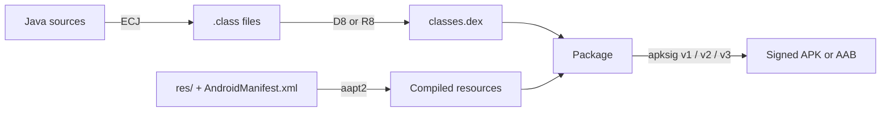

<p align="center">
 
</p>

<h1 align="center">Buildora</h1>

<p align="center">
  <b>A complete Android app builder that lives on your phone.</b><br>
  Write Java &amp; XML, preview your layouts, build, sign and install real APKs — no PC, no cloud.
</p>

<p align="center">
  
  
  
  
  
</p>

<p align="center">
  <a href="#-download">⬇️ Download</a> ·
  <a href="#-quick-start">🚀 Quick start</a> ·
  <a href="#-features">✨ Features</a> ·
  <a href="#-how-it-works">⚙️ How it works</a> ·
  <a href="#-faq">❓ FAQ</a>
</p>

---

## 📖 Contents

1. [What is Buildora?](#-what-is-buildora)
2. [Why Buildora?](#-why-buildora)
3. [Quick start](#-quick-start)
4. [Features](#-features)
5. [How it works](#-how-it-works)
6. [Your project folder](#-your-project-folder)
7. [Settings](#-settings-at-a-glance)
8. [Permissions explained](#-permissions-explained)
9. [Requirements](#-requirements)
10. [Limitations &amp; roadmap](#-limitations--roadmap)
11. [FAQ](#-faq)
12. [Troubleshooting](#-troubleshooting)
13. [Contributing](#-contributing)
14. [Third-party components](#-third-party-components)
15. [License](#-license)
16. [⬇️ Download](#-download)

---

## 📱 What is Buildora?

**Buildora** is an on-device Android IDE and build system. It contains a code editor, a visual layout preview, a library manager and a
full build pipeline — so you can go from an idea to a signed, installable APK **entirely on your phone**.

You write **Java** and **XML**, tap **▶ Run**, and a few seconds later the **Install** button appears. Everything — the compiler,
the resource compiler, the dexer and the signer — runs inside the app. Nothing is uploaded anywhere.

> **Who is it for?**
> Students learning Android, developers who want to code on the go, people without access to a PC, and anyone who wants to
> build small apps and tools quickly.

---

## 💡 Why Buildora?

| | |
|---|---|
| 🔒 **Private & offline** | Your code never leaves your device. Internet is only needed to download libraries or use Git. |
| ⚡ **Fast** | Incremental builds reuse compiled resources and recompile only the files you changed. Nothing changed? Run finishes instantly. |
| 🧰 **A real toolchain** | The same kinds of tools professional Android builds use: **aapt2, ECJ, D8/R8, apksig** — with variants, modules, ProGuard and AAB export. |
| 🧠 **Comfortable to code in** | Code completion, live error lines, refactoring, layout preview and a Logcat/crash viewer, built for a touch screen. |
| 📦 **Plenty of libraries** | A catalog of 126 popular libraries, automatic detection from your imports, and a progress dialog while they download. |
| 🆓 **Free & open** | MIT licensed. |

---

## 🚀 Quick start

1. **Install Buildora** (see [Download](#-download)) and open it.
2. Allow **All files access** when asked — projects live in shared storage so you can reach them from any file manager.
3. Tap **＋ → New project**. Pick a name, package id, icon and a template, then **Create**.
4. In the editor, tap **▶ Run**. Watch the live build progress.
5. When it says **Build successful**, tap **Install** — or **Download**, **Share** or **Open app**.

That's it. Your project and the finished APK are saved in:

```
/storage/emulated/0/Buildora/<Project_Name>/
```

---

## ✨ Features

### 🏠 Projects

- **New project wizard:** name, app name, package id, **app icon** (pick from the **Gallery**, a file, or use the default) with a **corner-radius** slider, min/target SDK, theme, orientation, version, internet permission
- **4 buildable templates:** Empty Activity · Counter Demo · WebView App · AppCompat Activity
- **Import** any folder — Gradle-style layouts are detected, including `applicationId`, SDK levels, versions, dependencies and modules
- **Clone** a Git repository (public, or private with a personal access token)
- Rename, duplicate, **export as ZIP**, delete, project info

### ✍️ Code editor

| | |
|---|---|
| **Syntax highlighting** | Java, XML, JSON, Gradle, properties, Smali |
| **Code completion** | Members through call chains, your own classes and fields, `R.id.*` / `R.string.*`, XML tags, attributes, values and `@resources`; auto-import |
| **Live error lines** | Red lines for XML and bracket mistakes while you type; compiler errors are marked in the editor after a failed build |
| **Editing** | Line numbers · undo/redo · auto-save · auto-indent · auto-close brackets and XML tags · code formatter |
| **Navigation** | Find & replace (regex, case) · go to line · open-file tabs · glass **file explorer** |
| **Touch friendly** | Two-finger **pinch zoom**, a **symbol bar** above the keyboard, small clean icons |
| **Look** | 6 color schemes · light / dark app theme · custom fonts · word wrap · adjustable size |

### 🔧 Refactoring &amp; code tools

- **Rename** symbols, classes (with the file, layout tags and manifest entries) and resources (Java, layouts, values and their files) — you review every match first
- **Extract method** — selected statements become a method; variables turn into parameters and the return value is detected
- **Organize imports**
- **Plain-language error hints** and a one-tap **Fix** for missing imports and missing libraries

### 👁 Previews

- **Layout preview:** tap the small **eye icon** on a layout XML to see your *real* compiled layout, with
  - phone and tablet sizes, portrait / landscape, **day / night**
  - tap a view to inspect its class, id and size, then **Go to XML**
  - save a screenshot
- **Markdown & HTML preview:** the same eye icon previews `README.md` and `.html` files

### 🐞 Logcat &amp; crash reports

- Live **Logcat** with level, text and "my app" filters, pause, clear and copy
- Apps you build in **debug** mode report **crashes** back to Buildora with a notification and a full stack trace — no special permission needed
- Optional one-time permission to read every app's log (the command is shown in the app)

### 📦 Libraries

- A **catalog of 126 libraries** — AndroidX, Material 3, Retrofit, OkHttp, Gson, Moshi, Glide, Coil, Room, Firebase, Media3/ExoPlayer, CameraX, WorkManager, DataStore, Lottie, MPAndroidChart and many more
- **Auto-detect:** Buildora reads your imports and layout tags, adds the libraries you need and downloads them — with a **live progress dialog**
- Maven resolver for Google Maven, Maven Central and JitPack, **AAR support**, latest-stable lookup (`group:artifact`), and your own `.jar` / `.aar` files
- Firebase **`google-services.json`** support
- Libraries that need an annotation processor or Gradle plugin are clearly marked

### 🏗️ Build system

| | |
|---|---|
| **Incremental builds** | Cached resources; only changed Java files (and the files that use them) are recompiled |
| **Runs in the background** | A foreground service with a progress notification — leave the app or lock the screen and the build continues |
| **Build variants** | debug / release / your own build types, **product flavors**, application-id and version suffixes, per-variant signing key and libraries, generated **`BuildConfig`** |
| **Multi-module projects** | Android and Java library modules |
| **Release tools** | **R8** shrinking, obfuscation and optimization with `mapping.txt` · **AAB export** · signature verification · zipalign &amp; **16 KB page-size** check |
| **ProGuard rules editor** | 15 one-tap presets (Gson, Retrofit/OkHttp, Moshi, Glide, Firebase, Room, WebView JS, Kotlin, EventBus, remove logs, …) |
| **Signing** | Generate, import and export keys; choose the active key per build type |

### 🔀 Git

Status · commit · pull · push, with your name, e-mail and access token set once in Settings.

---

## ⚙️ How it works

Buildora runs a complete build pipeline inside the app:



| Stage | Tool | What it does |
|---|---|---|
| Resources | **aapt2** | Compiles and links `res/`, the manifest and assets; generates `R.java` |
| Java | **ECJ** (Eclipse compiler) | Compiles your sources to bytecode (Java 8 language level — lambdas and method references work) |
| Dex | **D8** (debug) / **R8** (release) | Converts bytecode to Android's `classes.dex`; R8 also shrinks and obfuscates |
| Package | Buildora | Builds the APK (or AAB) with correctly aligned entries |
| Sign | **apksig** | Signs with v1/v2/v3 and verifies the result |

Libraries are downloaded from Maven repositories, merged (resources, manifests, assets, native libraries) and dexed once; the dexed result is cached for next time.

---

## 📁 Your project folder

A new project looks like this:

```
/storage/emulated/0/Buildora/MyApp/
├── MyApp.apk                       ← your built, signed app
├── buildora.json                   ← project settings (SDKs, versions, libraries, variants, modules)
├── build.gradle · settings.gradle  ← Gradle-compatible files, so the project also builds elsewhere
├── app/
│   ├── proguard-rules.pro          ← R8 / ProGuard rules (edit with presets in the app)
│   ├── libs/                       ← drop .jar / .aar files here
│   └── src/main/
│       ├── AndroidManifest.xml
│       ├── java/…                  ← your Java code
│       ├── res/                    ← layouts, drawables, values, icons
│       └── assets/
├── outputs/                        ← variant outputs: mapping.txt, preview screenshots
└── .buildora/                      ← build caches and logs (safe to delete)
```

Other variants build to `MyApp-<variant>.apk` (and `.aab` for bundles) in the same folder.

---

## 🎛️ Settings at a glance

| Section | Highlights |
|---|---|
| **Appearance** | Light / dark / follow system |
| **Code editor** | Color scheme · font and size · tab size · word wrap · line numbers · auto-indent · auto-close · auto-save · live error check · **code completion** · symbol bar |
| **Build** | Incremental builds · build notification · auto-detect libraries · crash reporter · verify signature · 16 KB alignment · auto-increment version code · release dex mode |
| **Signing** | Keys: generate, import, export, choose the active key |
| **Toolchain** | aapt2 / android.jar status, import or download your own, reset, clear caches |
| **New projects** | Default package prefix, SDK levels, icon corner radius |
| **Git** | Author name & e-mail · username · access token |

---

## 🔐 Permissions explained

| Permission | Why Buildora needs it |
|---|---|
| **All files access** | Projects and APKs are stored in `/storage/emulated/0/Buildora/` so you can reach them from any file manager |
| **Internet** | Downloading libraries and Git operations — never for your source code |
| **Install packages** | Installing the APK you just built |
| **Foreground service + notifications** | Keeping a build alive in the background and showing progress, results and crash reports |
| **Wake lock** | Keeping the CPU running while a build is in progress |
| **Read logs** *(optional)* | Only if you grant it yourself, to show other apps' logs in Logcat |

---

## 📋 Requirements

- Android **8.0 (API 26)** or newer
- An **ARM** phone is recommended (arm64 and arm32 are supported)
- About **300 MB** of free storage, plus space for your projects
- Internet only when adding libraries or using Git

---

## 🧭 Limitations &amp; roadmap

**Good to know today**

- Projects are **Java + XML**. Kotlin *libraries* work as dependencies, but Kotlin source files are not compiled.
- **No annotation processors** yet (Room's generated DAOs, Dagger/Hilt, Glide's generated API). Such libraries are marked in the catalog.
- **Modules** are compiled together with the app (merged sources, resources and manifests).
- **R8** shrinks code; resource shrinking is not included. AAB export creates a single `base` module.
- **Layout preview** shows complex library views as labelled boxes until you have done a first build; fragments and data binding are not rendered.
- Code completion knows `android.jar` and your own sources; library classes are not indexed yet.

**Ideas for the future** *(not promises)*

- Library-aware completion · annotation processor support · Kotlin
- Debugger basics · more refactorings · template marketplace

---

## ❓ FAQ

<details>
<summary><b>Is Buildora free?</b></summary>

Yes. It is open source under the MIT license.
</details>

<details>
<summary><b>Does it need an internet connection?</b></summary>

Only to download libraries (they are cached afterwards) or to use Git. Building apps without extra libraries works fully offline.
</details>

<details>
<summary><b>Where are my projects and APKs?</b></summary>

In `/storage/emulated/0/Buildora/<Project_Name>/` — the APK is right inside the project folder.
</details>

<details>
<summary><b>Can I publish the apps I build?</b></summary>

The apps are yours. Generate your own signing key in **Settings → Signing keys** (keep a backup — an app can only be updated with the same key),
use a **release** variant, and export an **AAB** if a store asks for one.
</details>

<details>
<summary><b>Can I open my project on a computer?</b></summary>

Yes — projects include Gradle-compatible files, and you can export or clone them with Git.
</details>

<details>
<summary><b>Why is the Buildora APK so large?</b></summary>

It carries the whole toolchain: <code>android.jar</code>, the Java compiler, D8/R8, the signer, Git and the resource compiler.
</details>

<details>
<summary><b>Where are my signing keys stored?</b></summary>

In the app's private storage. Passwords are kept in the app's private preferences. Export your keys from **Settings → Signing keys** to back them up.
</details>

<details>
<summary><b>Does the Buildora app collect my data?</b></summary>

No analytics or tracking are built in. Your code stays on your device.
</details>

---

## 🛠️ Troubleshooting

| Problem | What to do |
|---|---|
| **Build error** | Tap an error in the list to jump to the line, or **Copy all** to share it |
| `aapt2 cannot run` | Open **Settings → Toolchain** and import or download an `aapt2` for your CPU |
| Projects not saving / not visible | Grant **All files access** in Android's app settings |
| Library download fails | Check your connection, then remove or fix the dependency in **Libraries** |
| Strange build behaviour after a crash | **Settings → Build → Clear incremental build cache** |
| No crash reports from my app | Use a **debug** build and keep **Crash reporter** switched on in Settings |
| Logcat shows only Buildora's own log | Grant the optional read-logs permission once (the command is shown in Logcat) |

---

## 🤝 Contributing

Issues and pull requests are welcome. When reporting a build problem please include:

- your Android version and device (CPU architecture),
- the text from **Copy all** in the error dialog,
- the Buildora version (Settings → About).

---

## 📚 Third-party components

Buildora bundles open-source software, each under its own license: the **Eclipse Compiler for Java (ECJ)**, **R8 / D8**, **apksig**,
**Eclipse JGit**, **SLF4J**, **AndroidX** and the Android SDK **`android.jar`** and **`aapt2`**. Please see each project for its license terms.

---

## 📄 License

Buildora's own source code is released under the [MIT License](../LICENSE).
© 2026 TENIx

---

## ⬇️ Download

<p align="center">
  <b>Get Buildora from this repository's Releases page.</b>
</p>

<p align="center">
  👉 <a href="../../../releases/latest"><b>Download the latest Buildora APK</b></a> 👈
</p>

1. Open the **[Releases](../../../releases)** page of this repository (or the **Releases** section on the right side of the repository home page).
2. Under the newest release, download **`Buildora.apk`** from **Assets**.
3. Open the file on your phone and allow *"Install unknown apps"* for your browser or file manager when Android asks.
4. Launch Buildora and grant **All files access**.
5. Tap **＋ → New project → ▶ Run** and build your first app.

> 💡 Installing a newer release over an older one keeps your projects and signing keys.

<p align="center">
  <sub>Made with ❤️ by <b>TENIx</b> · Build apps anywhere.</sub>
</p>
